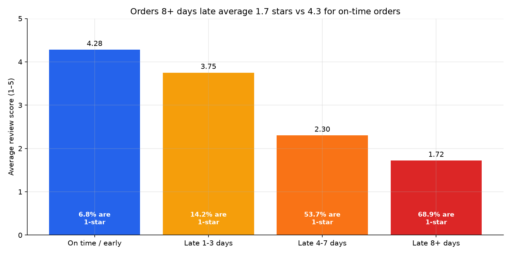

# Olist E-Commerce Performance Analysis (SQL)

Analysis of ~100K orders from Olist, a Brazilian online marketplace. It looks at growth, product mix, customer retention, delivery and seller risk. All metrics are calculated in **SQL**. Python only loads the data and draws the charts.



## Business questions
1. How fast is revenue growing, and is order value holding up?
2. Which product categories drive revenue?
3. Do customers come back for a second order?
4. Does late delivery hurt customer satisfaction, and by how much?
5. Which regions have delivery problems?
6. How dependent is the marketplace on its biggest sellers?

## Dataset
[Brazilian E-Commerce Public Dataset by Olist](https://www.kaggle.com/datasets/olistbr/brazilian-ecommerce) (Kaggle, CC BY-NC-SA 4.0): 9 related tables covering orders, order items, customers, products, sellers, payments and reviews. The data runs Sep 2016 – Oct 2018, and the trend analysis uses Jan 2017 – Aug 2018. Amounts are in Brazilian reais (R$).

```
customers ──< orders ──< order_items >── products ── category_translation
                 │            └──────── sellers
                 ├──< order_payments
                 └──< order_reviews
```

## Approach
- Loaded the 8 CSVs into a SQLite database and ran a data quality check: 97% of orders delivered, 8 delivered orders missing a delivery date.
- Wrote 8 analysis queries in [`sql/queries.sql`](sql/queries.sql). They use multi-step **CTEs**, the window functions **LAG, RANK, ROW_NUMBER, NTILE and running SUM() OVER**, CASE bucketing, date math with JULIANDAY, and joins across 5 tables.
- Removed duplicate reviews (latest review per order with ROW_NUMBER) and rolled order items up to order level so averages aren't double-counted.
- Charted the results with matplotlib and saved every result table to [`results/`](results/).

## Key findings
| Area | Finding |
|---|---|
| Growth | Revenue grew ~9x from Jan 2017 to the Nov 2017 Black Friday peak (R$1.15M). H1 2018 was +185% vs H1 2017, but 2018 was flat at ~R$1.0–1.1M/month. |
| Order value | Average order value stayed at R$146–170, so growth came from more orders, not bigger baskets. |
| Categories | The top 10 categories make up 62% of revenue, and none is above 10%. Watches & gifts ranks #2 on an R$199 average price. |
| Retention | Only **3.0%** of 93K customers placed a second order. |
| Delivery → reviews | 8.2% of orders arrive late. Orders 8+ days late average **1.72 stars (69% one-star)**, vs **4.28** for on-time orders. |
| Regions | Rio de Janeiro, the #2 market (R$2.1M), has a **13.5%** late rate vs 5.9% in São Paulo. Bahia (14.0%) and Espírito Santo (12.2%) are also high. |
| Sellers | The top 10% of sellers (297) produce **67%** of revenue. |
| Payments | 77% of orders are paid by credit card, averaging 3.5 installments. |

## Recommendations
1. **Fix late deliveries first:** set carrier SLAs and send proactive delay messages, starting with RJ, BA and ES.
2. **Launch a second-purchase campaign:** a post-delivery coupon, since only 3% of customers reorder.
3. **Start a key-account program** for the top 10% of sellers.
4. **Promote high-ticket categories** with interest-free installment offers.

## Repository layout
```
01-ecommerce-sql-analysis/
├── data/          # raw Olist CSVs (source: Kaggle)
├── sql/           # queries.sql — every metric in this project
├── notebooks/     # ecommerce_sql_analysis.ipynb — runs the SQL, charts, narrative
├── images/        # exported charts
└── results/       # query outputs as CSV + findings.md
```

## How to run
```bash
pip install pandas matplotlib jupyter
cd notebooks && jupyter notebook ecommerce_sql_analysis.ipynb
```
SQLite is built into Python, so no database server is needed. The queries are standard SQL with window functions and also run in PostgreSQL with minor date-function changes.
