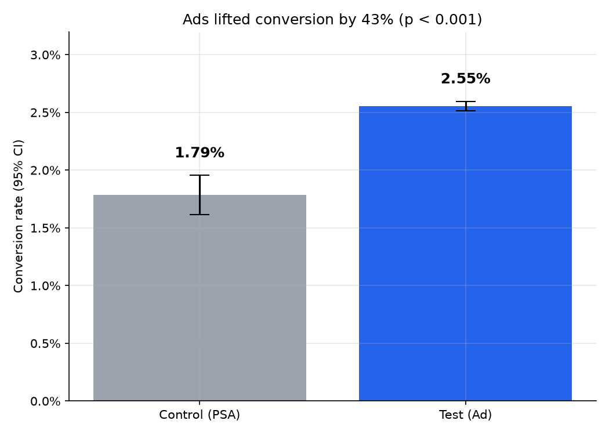
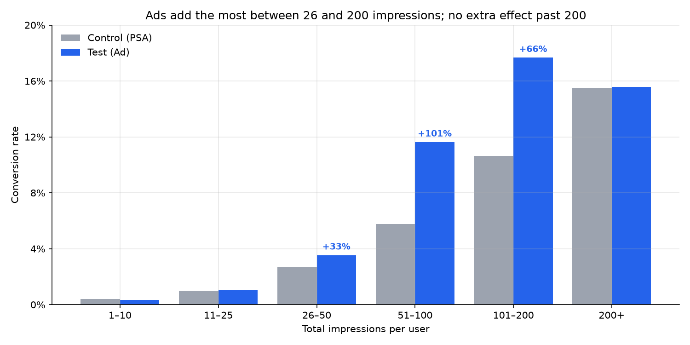

# Marketing Campaign A/B Test: Did the Ads Work?

Statistical evaluation of an ad campaign tested on **588,101 users**. It measures whether the ads increased purchases and how many conversions they actually added. It also finds when, and at what frequency, the ads work best.



## Objective
- **Primary:** Test whether users who saw the product ad converted at a higher rate than a control group that saw a public-service announcement (PSA) in the same ad slots.
- **Business impact:** Estimate the *incremental* conversions caused by the ads, as opposed to conversions that would have happened anyway.
- **Optimization:** Find the days, hours and ad frequencies where the campaign works best, to guide budget reallocation.

Hypotheses (two-sided, α = 0.05): H₀ says the two groups have the same conversion rate. H₁ says they differ.

## Dataset
[Marketing A/B Testing](https://www.kaggle.com/datasets/faviovaz/marketing-ab-testing) (Kaggle): one row per user, with test group (`ad` / `psa`), whether they converted, total ads seen, and the day and hour they saw the most ads. Split: 96% ad / 4% PSA, by design.

## Approach
1. **Data cleaning:** standardized column names and confirmed there are no missing values or duplicate users.
2. **Sanity checks:** exposure balance (standardized mean difference = 0.001) and day-mix balance (max gap 2.6 pts). The day gap was handled with a per-day re-test.
3. **Primary test:** a two-proportion z-test with a 95% CI on the difference, cross-checked with a chi-square test and a parametric bootstrap CI on relative lift.
4. **Impact sizing:** incremental conversions = ad-group users × absolute lift.
5. **Segment analysis:** lift by day, conversion by hour, and a dose–response analysis by impression band.

## Results
| Question | Answer |
|---|---|
| Did ads increase conversion? | **Yes.** 2.55% vs 1.79%: **+0.77 pts (95% CI +0.60 to +0.94)**, **+43% relative**, z = 7.37, p ≈ 1.7×10⁻¹³ |
| Incremental conversions | **~4,343** (95% CI 3,360 – 5,326), only **30%** of the 14,423 ad-group conversions |
| Robust across days? | The ad group is higher on all 7 days, significantly on 5. Monday (3.3%) and Tuesday (3.0%) are best. |
| Best hours | 2–9 PM converts at 2.90% vs 1.07% for 1–4 AM |
| Best frequency | The ad's advantage peaks at 51–100 impressions (+101%) and 101–200 (+66%). There is **no difference past 200** (15.6% vs 15.5%). |



## Recommendations
1. **Keep the campaign running.** The lift is large and statistically solid.
2. **Measure ROI on ~4.3K incremental conversions, not all 14.4K.** Counting every conversion overstates the return ~3.3x.
3. **Cap frequency near 200 impressions per user** and move that spend to users under 50 impressions.
4. **Shift budget to Mon/Tue and the 2–9 PM window**, and away from overnight slots.
5. **Next experiment:** randomize frequency caps to confirm the dose–response effect causally.

**Limitations:** There is no cost or revenue data, so ROI can't be calculated in dollars. The day, hour and frequency results are observational.

## Repository layout
```
02-marketing-ab-test/
├── data/        # marketing_AB.csv (source: Kaggle)
├── notebooks/   # marketing_ab_test.ipynb — full analysis
├── images/      # exported charts
└── results/     # result tables (CSV) + findings.md
```

## How to run
```bash
pip install pandas numpy scipy matplotlib jupyter
cd notebooks && jupyter notebook marketing_ab_test.ipynb
```
