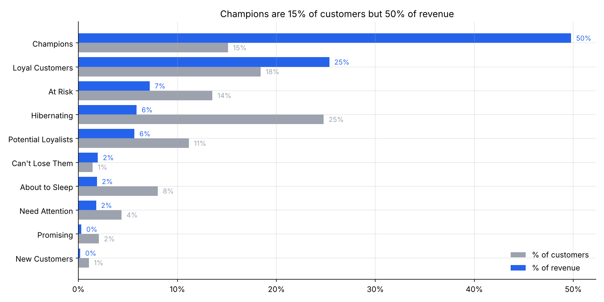
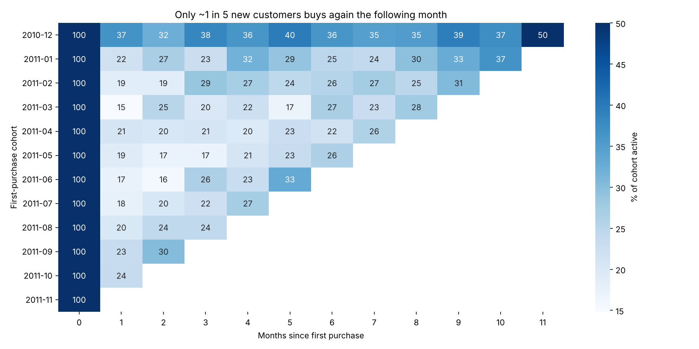

# Customer Segmentation for an Online Gift Retailer (RFM + K-Means)

This project turns a year of raw transactions (541,909 lines) from a UK online gift retailer into **10 customer segments**, each with a recommended marketing action. Unsupervised clustering confirms the segments reflect real patterns in the data, and a cohort analysis shows how quickly new customers drop off.



## Business problem
The retailer sends every customer the same promotions. Marketing wants to know who its valuable customers are and who is about to churn, so it can stop discounting to customers who would buy anyway and focus win-back spend where it pays.

## Objectives
1. Clean the raw transaction log into reliable customer-level data.
2. Score each customer on **Recency, Frequency and Monetary value (RFM)** and assign business segments.
3. Validate the segments with **K-means clustering**.
4. Measure **monthly cohort retention**.
5. Recommend a marketing action for each segment.

## Dataset
[UCI Online Retail](https://archive.ics.uci.edu/dataset/352/online+retail) (Chen, Sain & Guo, 2012; CC BY 4.0). It covers all transactions of a UK-based online gift retailer from 1 Dec 2010 to 9 Dec 2011, and many of its customers are wholesalers.

## Approach
1. **Cleaning (audited step by step):** removed guest checkouts (no CustomerID), cancellations (£611K, 6.5% of gross), zero-price lines, postage and fee codes, and exact duplicates. That leaves 541,909 → **391,150 lines, 4,334 customers, £8.74M revenue**. The full log is in [`results/cleaning_log.csv`](results/cleaning_log.csv).
2. **RFM features:** recency in days, frequency as distinct invoices, monetary as total spend.
3. **Scoring:** quintile scores (1–5) for each feature, mapped onto the standard 10-segment R×F grid.
4. **Validation:** K-means on log-transformed, standardized RFM features. k = 4 was chosen with the elbow and silhouette methods, and the clusters were cross-tabulated against the RFM segments.
5. **Cohort retention:** monthly first-purchase cohorts, showing the share of each cohort still active in later months.

## Key findings
| Finding | Number |
|---|---|
| Champions (15% of customers) generate | **50% of revenue** |
| Champions + Loyal Customers | **34% of customers → 75% of revenue** |
| At Risk + Can't Lose Them | **650 customers, £802K lifetime revenue**, silent ~4–5 months on average |
| Hibernating customers | 25% of customers, only 6% of revenue |
| New-customer month-1 retention | median **20%** (range 15–37%) |
| Dec 2010 cohort (existing wholesale accounts) | **50%** still active 11 months later |
| Seasonality | Sep–Nov revenue averages ~1.8x the Jan–Aug monthly average |
| K-means agreement | 76% of Champions → VIP cluster; 96% of Hibernating → Lost low-value cluster |



## Recommended actions
| Segment | Action |
|---|---|
| Champions | VIP program, early access, referral asks; **no discounts needed** |
| Loyal Customers | Loyalty tiers, bundles, cross-sell |
| Potential Loyalists / New / Promising | Onboarding emails and a second-order incentive within 30 days |
| At Risk / Can't Lose Them | Personal outreach to wholesale accounts, a win-back offer, a "what changed?" survey |
| Need Attention / About to Sleep | Limited-time offer timed before the Sep–Nov peak |
| Hibernating | Low-cost seasonal email only |

**Deliverable for marketing:** [`results/customer_segments.csv`](results/customer_segments.csv) has one row per customer with R/F/M values, scores, segment and cluster, ready to import into an email or CRM tool.

## Repository layout
```
03-customer-segmentation-rfm/
├── data/        # online_retail.xlsx (source: UCI)
├── notebooks/   # customer_segmentation_rfm.ipynb — full analysis
├── images/      # exported charts
└── results/     # customer_segments.csv, segment summary, cohorts, cleaning log, findings.md
```

## How to run
```bash
pip install pandas numpy matplotlib seaborn scikit-learn openpyxl jupyter
cd notebooks && jupyter notebook customer_segmentation_rfm.ipynb
```
