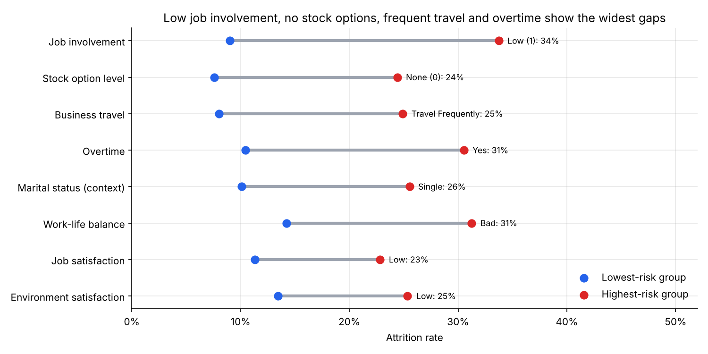
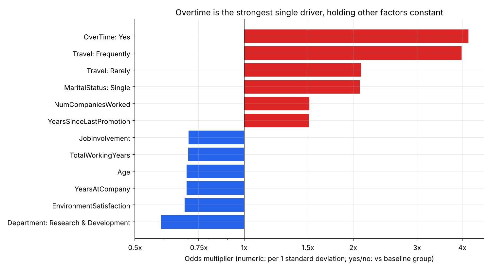

# Employee Attrition: What Drives People to Leave?

People analytics on 1,470 employees: where attrition is concentrated, which workplace factors HR can act on, a risk model that flags employees for retention conversations, and an estimate of what attrition costs.



## Business problem
About 1 in 6 employees leave, and every departure costs recruiting, onboarding and lost productivity. HR leadership wants to know which factors it can change and where to focus retention effort.

## Objectives
1. Measure attrition across departments, roles, levels, tenure, age and pay.
2. Identify the **actionable workplace levers** most strongly linked to leaving.
3. Build an explainable **logistic regression risk model** and turn it into risk tiers.
4. Estimate the **cost of attrition** and the savings from a realistic reduction.

## Dataset
[IBM HR Analytics Employee Attrition & Performance](https://www.kaggle.com/datasets/pavansubhasht/ibm-hr-analytics-attrition-dataset): 1,470 employees and 35 attributes covering demographics, job, pay, satisfaction surveys, overtime, travel and tenure. *It is a fictional dataset created by IBM data scientists.*

## Approach
1. **Data checks:** no missing values or duplicates. Dropped 3 columns that hold the same value for everyone.
2. **Segment analysis:** attrition rates by role, tenure, age and income, with chi-square and Mann-Whitney significance tests.
3. **Lever analysis:** compared the highest-risk and lowest-risk group for each workplace factor HR can influence.
4. **Model:** logistic regression with class balancing, standardized numeric features and one-hot categories. Validated on a hold-out test set and with 5-fold cross-validation. Results are reported as odds multipliers.
5. **Action:** grouped employees into Low, Medium and High risk tiers and estimated cost with an explicit assumption.

## Key findings
| Finding | Number |
|---|---|
| Overall attrition | **16.1%** (237 of 1,470) |
| Overtime vs no overtime | **30.5% vs 10.4%**; model odds **~4.2x** with other factors held constant |
| Frequent travelers vs non-travelers | 25% vs 8%; model odds ~4.0x |
| Sales Representatives | **40%**, the highest role (Research Directors: 2.5%) |
| First-year employees | **35%** leave |
| No stock options vs level 1–2 | 24% vs 8–9% |
| Median monthly pay, leavers vs stayers | $3,202 vs $5,204 (p < 0.001) |
| Risk model | ROC-AUC **0.82** (5-fold CV 0.818 ± 0.012) |
| High-risk tier | **22% of employees, 68% of leavers** |
| Estimated cost of attrition (assumes replacement = 50% of salary) | **~$6.8M**. A 20% reduction saves ~$1.4M. |



## Recommendations
1. **Audit and cap overtime**, starting with Sales Representatives and Laboratory Technicians.
2. **Strengthen first-year onboarding** with 30/60/90-day check-ins.
3. **Extend stock options to entry-level staff.**
4. **Review Sales Representative pay and career paths.**
5. **Limit frequent travel** or compensate for it.
6. **Run quarterly stay-interviews** for the High-risk tier ([`results/employee_risk_scores.csv`](results/employee_risk_scores.csv)).

**Limitations:** The data is fictional and a single snapshot, so the results show associations, not causes. The cost figure depends on the replacement-cost assumption, which is adjustable in the notebook.

## Repository layout
```
04-hr-attrition-analysis/
├── data/        # hr_employee_attrition.csv (source: IBM / Kaggle)
├── notebooks/   # hr_attrition_analysis.ipynb
├── images/      # charts
└── results/     # rate tables, odds ratios, risk tiers, employee risk scores, findings.md
```

## How to run
```bash
pip install pandas numpy scipy scikit-learn matplotlib seaborn jupyter
cd notebooks && jupyter notebook hr_attrition_analysis.ipynb
```
