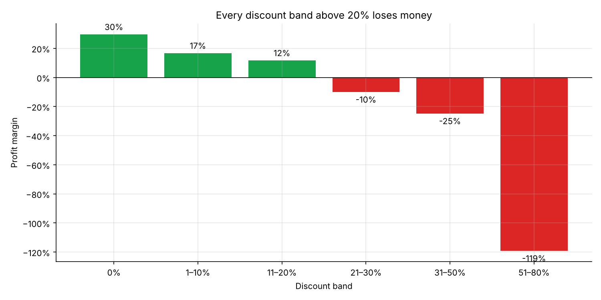
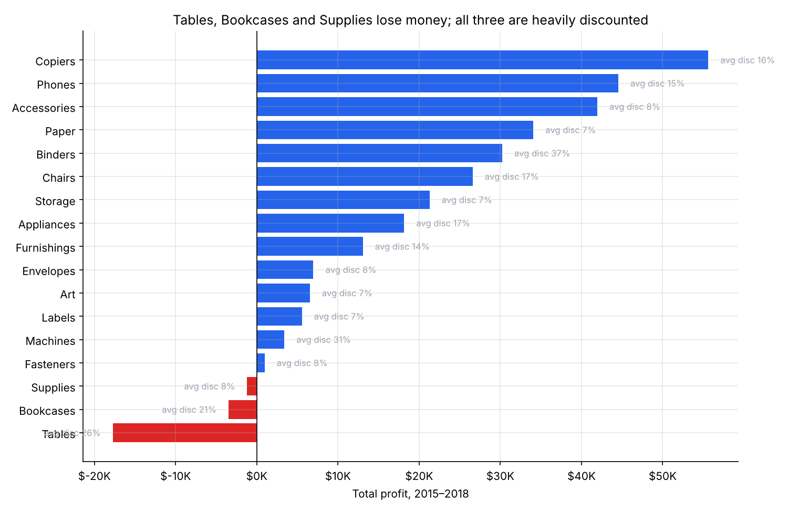

# Superstore Sales & Profitability Analysis (Python + Excel)

Finds where a US retailer makes and loses money, and shows that **deep discounting is the main profit leak**. The analysis is done in Python, and the deliverable is an **interactive Excel workbook** that regional managers can filter themselves.



## Business problem
Superstore's sales grew 51% in four years, but leadership suspects profit isn't keeping up and that discounting is to blame. Regional managers want a self-service Excel view of their numbers.

## Objectives
1. Clean the raw export into analysis-ready tables.
2. Track sales, profit and margin by year.
3. Find the loss-making sub-categories and states.
4. Quantify the effect of discount levels on profit.
5. Measure return rates by region.
6. Deliver a formula-driven Excel workbook for regional managers.

## Dataset
Tableau's **Sample – Superstore** (fictional US office supplies, furniture and technology retailer): 9,994 order lines, Jan 2015 – Dec 2018, raw export ([source repo](https://github.com/leonism/sample-superstore)).

## Data cleaning
The raw file had **three tables stacked into one CSV**:
| Issue | Fix |
|---|---|
| A managers table (`Person / Region`) and a returns table (`Returned / Order ID`) appended under the 9,994 orders, pushed into the first two columns | Split into 3 clean tables: orders, regional managers, returned orders |
| 800 return rows, 504 of them duplicates | Deduplicated to **296 returned orders**, all matched to Orders |
| 11 missing postal codes (all Burlington, VT) | Filled with 05401 |
| Dates stored as text | Parsed. Added Year, Ship Days, Returned and Manager columns |

## The Excel workbook — [`results/Superstore_Sales_Analysis.xlsx`](results/Superstore_Sales_Analysis.xlsx)
| Sheet | What it does |
|---|---|
| **Dashboard** | **Region and Year dropdowns** (data validation) drive 10 KPIs, a category table and a trend chart. Built with SUMIFS, COUNTIFS, AVERAGEIFS and wildcard criteria, plus INDEX/MATCH for the manager name and a reconciliation check. |
| **Sub-Category** | Profit, margin and average discount for 17 sub-categories, with data bars, red flags for losses and a bar chart |
| **Discounts** | Discount bands with editable bounds, plus a **what-if discount cap** input that shows the profit impact |
| **Regions** | Region scorecard with manager lookup, margin and return rate, and red-flag conditional formatting |
| **States** | 49 states sorted worst-first, with loss rows highlighted |
| **Data** | Clean orders as an Excel Table (9,994 rows) |
| Managers / Returns / Notes | Lookup tables, colour key, sources and cleaning notes |

All **397 summary cells are live formulas**, with zero errors, and the totals reconcile to the Data sheet. The workbook is generated by [`scripts/build_excel_workbook.py`](scripts/build_excel_workbook.py) (openpyxl).

## Key findings
| Finding | Number |
|---|---|
| Sales 2015 → 2018 | $484K → $733K (**+51%**). Margin 10.2% → 12.7%. |
| Total profit / margin | $286K / 12.5% |
| Loss-making sub-categories | **Tables (−$17.7K, 26% avg discount)**, Bookcases (−$3.5K), Supplies (−$1.2K) |
| Discount bands above 20% | **All lose money**. 51–80% discounts run a −119% margin. |
| Lines discounted >20% | 14% of lines, **−$135K profit**. Profit on all other lines is $422K. |
| Loss-making states | 10 of 49 (−$98K). Texas is worst (−$25.7K). Average discount 34% vs 4% elsewhere. |
| Central region | Lowest margin (7.9%) and highest average discount (24%) |
| West region | Highest profit, but **11.7% of orders returned** vs ~3% elsewhere |



## Recommendations
1. **Cap discounts at 20%**, with manager approval for exceptions.
2. **Reprice or stop discounting Tables and Bookcases.**
3. **Review discount practices in the Central region and in TX, OH, PA and IL** with their regional managers, using the workbook.
4. **Grow the profitable core:** Copiers (37% margin), Paper, Accessories and Phones.
5. **Investigate West's return rate.**

## Repository layout
```
05-superstore-sales-excel/
├── data/        # superstore_raw.csv + clean/ (orders, managers, returns)
├── notebooks/   # superstore_sales_analysis.ipynb — cleaning + analysis
├── scripts/     # build_excel_workbook.py — generates the Excel deliverable
├── images/      # charts
└── results/     # Superstore_Sales_Analysis.xlsx, summary CSVs, findings.md
```

## How to run
```bash
pip install pandas matplotlib openpyxl jupyter
cd notebooks && jupyter notebook superstore_sales_analysis.ipynb   # cleans data + analysis
cd .. && python scripts/build_excel_workbook.py                     # builds the workbook
```
Open the workbook in Excel. Formulas recalculate on open.
