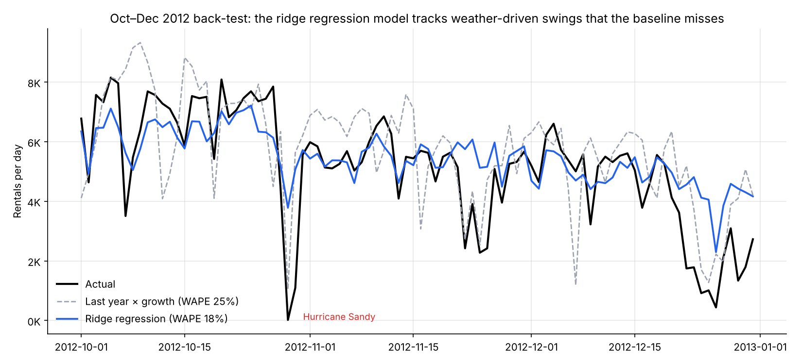
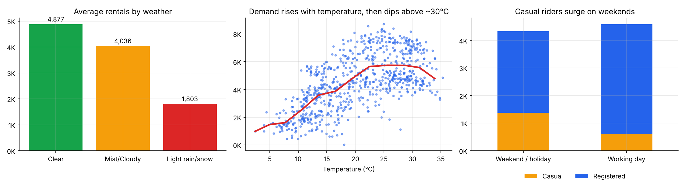

# Daily Demand Forecasting: Capital Bikeshare

Forecasts daily bike-rental demand in Washington, DC so operations can plan rebalancing trucks and staff a week ahead. A weather- and calendar-aware regression model is back-tested against the "last year's numbers" approach the team uses today.



## Business problem
Operations plans trucks, mechanics and station staff from last year's numbers and is often over- or under-staffed. It wants a daily forecast that uses the calendar and the weather forecast, and an explanation of what drives demand.

## Objectives
1. Describe demand patterns: trend, seasonality, weekday vs weekend, weather.
2. Build simple baselines the team could use today.
3. Build a regression model with calendar and weather features.
4. Back-test on a held-out quarter (Oct–Dec 2012) and express the error in bikes per day.

## Dataset
[UCI Bike Sharing Dataset](https://archive.ics.uci.edu/dataset/275/bike+sharing+dataset) (Fanaee-T & Gama, 2013): 731 days of Capital Bikeshare rentals (2011–2012), split into casual and registered riders, with temperature, humidity, wind, weather condition and holiday flags.

## Approach
- **Preparation:** confirmed there are no missing values and no gaps in the dates. Converted the normalized weather fields back to °C, %, and km/h.
- **Patterns:** trend and seasonality, weather impact, temperature response, casual vs registered mix.
- **Time-based back-test:** trained on Jan 2011 – Sep 2012 and tested on 92 unseen days in Oct–Dec 2012. No random split, so no future data leaks into training.
- **Baselines:** same day last year, last year × year-to-date growth, and the same weekday last week.
- **Models:** Ridge regression (trend, month, weekday, holiday, weather, temperature with a squared term, humidity, wind) and a gradient boosting model.
- **Metrics:** MAE in bikes per day, and **WAPE** (total absolute error ÷ total demand). MAPE isn't usable because Hurricane Sandy produced a 22-rental day.

## Results (Oct–Dec 2012 back-test)
| Method | WAPE | MAE (bikes/day) |
|---|---|---|
| Last year, same day | 38.4% | 1,982 |
| Last week, same weekday | 28.2% | 1,458 |
| Last year × growth (current approach) | 24.9% | 1,288 |
| Gradient boosting | 21.2% | 1,097 |
| **Ridge regression** | **18.2%** | **942** |

- Ridge cuts the average daily error by **27%** vs the current approach and **halves the median daily error** (542 vs 977 bikes).
- Days missed by more than 1,500 bikes drop from **31 to 16** out of 92.
- The simpler, explainable linear model beat gradient boosting. Tree models can't extrapolate a trend, which likely hurt it given the strong growth and only 2 years of history.

## What drives demand
| Driver | Effect |
|---|---|
| Growth | 2012 demand was **+65%** vs 2011. The trend adds ~2,000 bikes/day per year. |
| Weather | Rain or snow days average 1,803 rentals vs 4,877 on clear days (−63%). With other factors held equal, rain costs ~1,670 bikes and mist ~430. |
| Temperature | Demand rises steeply up to ~22°C, plateaus, and dips above ~30°C |
| Weekends | Casual riders are **32%** of weekend demand vs 13% on working days |
| Largest misses | Hurricane Sandy (29–30 Oct), Thanksgiving, Christmas week |



## Recommendations
1. **Switch planning to the regression forecast**, refreshed daily from the weather forecast.
2. **Add weather triggers:** on forecast rain days, reduce truck shifts and move mechanics to repairs.
3. **Plan weekends separately:** stock tourist and park stations for casual riders.
4. **Override manually for holidays and extreme-weather alerts.**
5. **Next:** retrain monthly, and build an hourly, station-level model for rebalancing.

**Limitations:** Only two years of history. Observed weather is used in place of forecasted weather, so live accuracy will be somewhat lower.

## Repository layout
```
06-demand-forecasting/
├── data/        # bike_sharing_daily.csv (source: UCI)
├── notebooks/   # bike_demand_forecasting.ipynb
├── images/      # charts
└── results/     # model_comparison.csv, back-test forecasts, weather effects, findings.md
```

## How to run
```bash
pip install pandas numpy scikit-learn matplotlib jupyter
cd notebooks && jupyter notebook bike_demand_forecasting.ipynb
```
