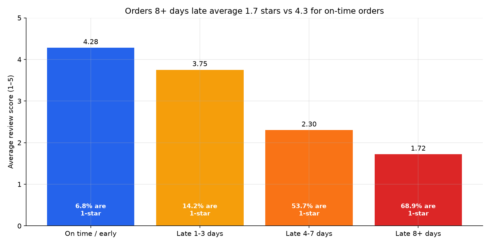
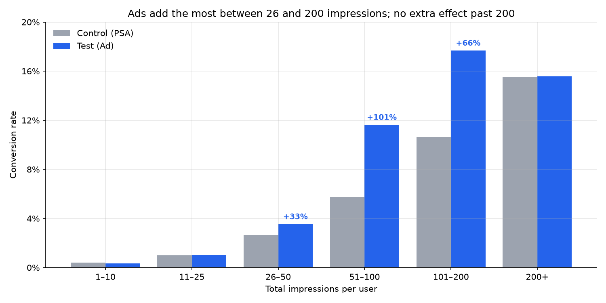
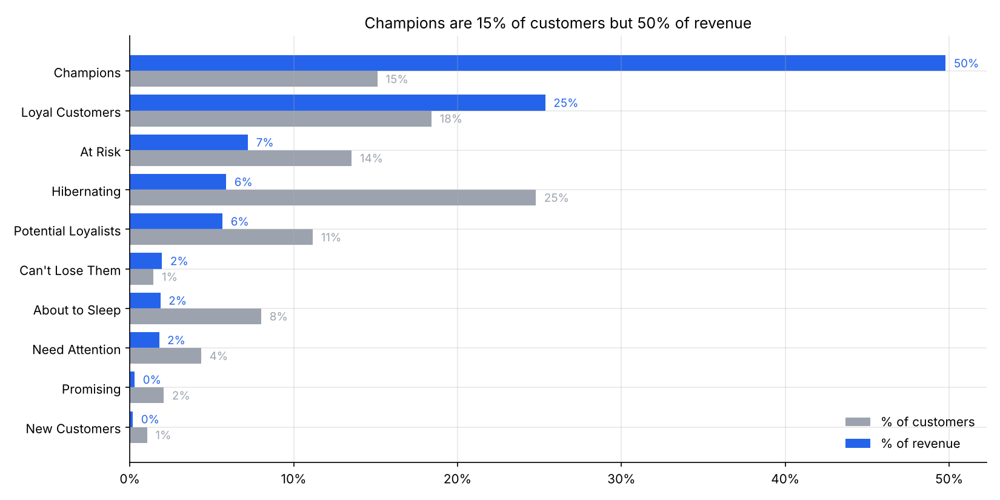
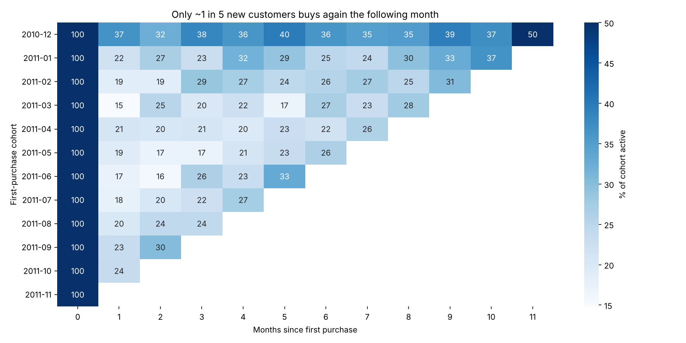
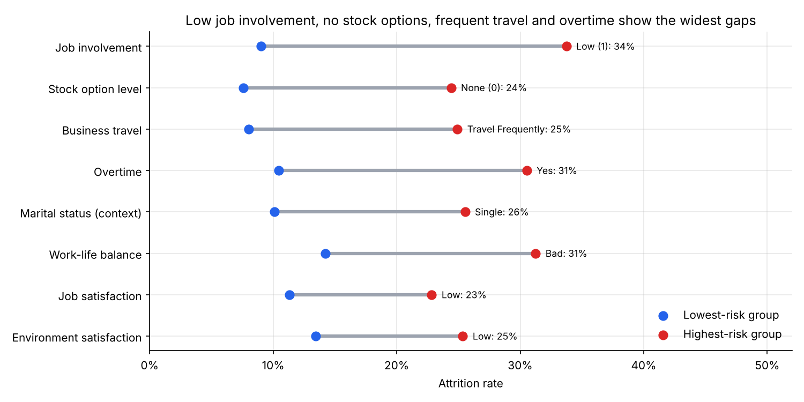
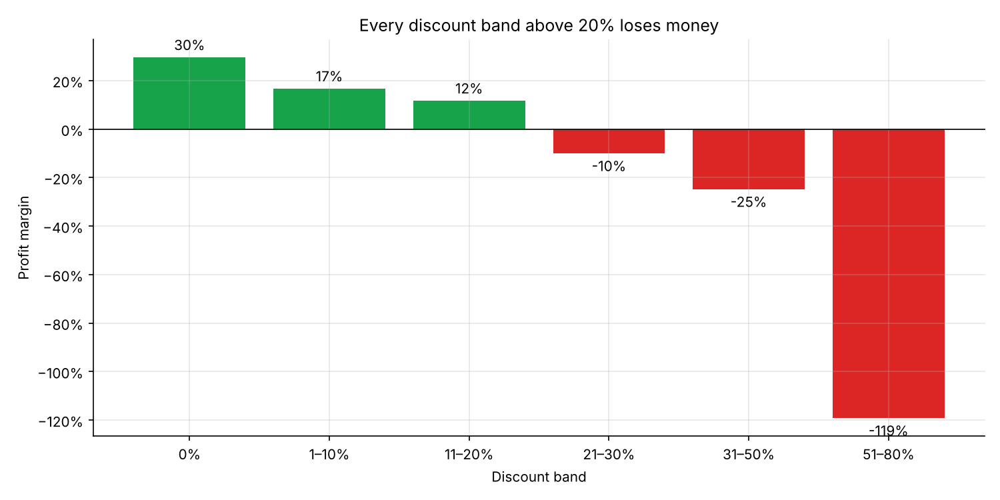
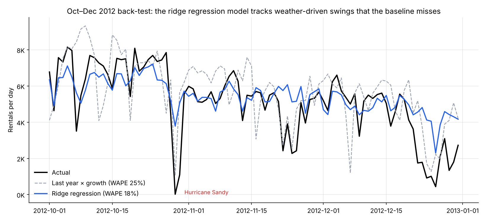

# Daljeet Kaur — Data Analytics Portfolio

Data analyst with an MBA (Texas A&M University–Corpus Christi, 4.0 GPA) and a background in product and market analysis. These projects work through real business questions end to end on public datasets: cleaning the data, analyzing it in SQL, Python and Excel, testing results statistically, charting them, and turning them into recommendations a business can act on.

📍 Austin, TX · Open to remote · [LinkedIn](https://linkedin.com/in/your-profile) · daljeetchanna93@gmail.com

## Projects

| # | Project | Business question | Skills | Headline result |
|---|---|---|---|---|
| 1 | [**E-Commerce Performance Analysis (SQL)**](01-ecommerce-sql-analysis/) | What drives growth, satisfaction and risk in a 100K-order marketplace? | SQL (CTEs, window functions: LAG, RANK, NTILE, ROW_NUMBER), multi-table joins, SQLite, pandas, matplotlib | Orders 8+ days late average **1.7★ vs 4.3★** on time; top 10% of sellers = **67%** of revenue; only **3%** of customers reorder |
| 2 | [**Marketing Campaign A/B Test**](02-marketing-ab-test/) | Did the ad campaign actually increase conversions? | Hypothesis testing (z-test, chi-square, bootstrap CI), experiment sanity checks, impact sizing, SciPy | Ads lifted conversion **+43% (2.55% vs 1.79%, p < 0.001)**, ~**4,300** incremental conversions; no added effect beyond 200 impressions |
| 3 | [**Customer Segmentation (RFM + K-Means)**](03-customer-segmentation-rfm/) | Who are the best customers, and who is about to churn? | Data cleaning, RFM scoring, K-means clustering (scikit-learn), cohort retention analysis, seaborn | **15%** of customers (Champions) = **50%** of revenue; **650** at-risk customers worth **£802K**; month-1 retention **20%** |
| 4 | [**Employee Attrition Drivers (People Analytics)**](04-hr-attrition-analysis/) | Why do employees leave, and who is at risk? | Segment analysis, chi-square tests, logistic regression (odds ratios, cross-validated AUC), risk tiers, cost modeling | Overtime: **30.5% vs 10.4%** attrition (~4.2x odds); high-risk tier = **22% of staff, 68% of leavers**; ~$6.8M estimated attrition cost |
| 5 | [**Superstore Sales & Profitability (Python + Excel)**](05-superstore-sales-excel/) | Where does the company make and lose money? Is discounting to blame? | Messy-data cleaning, pandas, **Excel workbook**: SUMIFS/COUNTIFS/AVERAGEIFS, INDEX/MATCH, dropdown-driven dashboard, conditional formatting, what-if analysis | Discounts above 20% lost **$135K**; Tables lose **$17.7K**; 10 of 49 states unprofitable |
| 6 | [**Daily Demand Forecasting**](06-demand-forecasting/) | How many bikes will riders need each day next quarter? | Time-series back-testing, baselines, Ridge regression & gradient boosting (scikit-learn), MAE/WAPE | Forecast error cut **27%** vs "last year" planning (WAPE 18% vs 25%); rain removes ~1,670 rentals/day |

## Highlights
<p>


</p>
<p>


</p>
<p>


</p>
<p>

</p>

## Each project includes
- **README:** business problem, objectives, data, approach, findings and recommendations
- **Notebook:** the full analysis with code, charts and commentary, viewable directly on GitHub
- **results/:** output tables (CSV), a one-page `findings.md`, and for project 5 the Excel workbook
- **images/:** exported charts

## Tools
`SQL` · `Excel` (SUMIFS, INDEX/MATCH, data validation, conditional formatting) · `Python` · `pandas` · `NumPy` · `matplotlib` · `seaborn` · `SciPy` · `scikit-learn` · `openpyxl` · `SQLite` · `Jupyter` · `Git`

## Run locally
```bash
git clone https://github.com/<your-username>/data-analytics-portfolio.git
cd data-analytics-portfolio
pip install -r requirements.txt
jupyter notebook
```

## Data sources
- Olist, [Brazilian E-Commerce Public Dataset](https://www.kaggle.com/datasets/olistbr/brazilian-ecommerce) (CC BY-NC-SA 4.0)
- F. Vaz, [Marketing A/B Testing](https://www.kaggle.com/datasets/faviovaz/marketing-ab-testing) (Kaggle)
- D. Chen, [Online Retail](https://archive.ics.uci.edu/dataset/352/online+retail), UCI Machine Learning Repository (CC BY 4.0)
- IBM, [HR Analytics Employee Attrition & Performance](https://www.kaggle.com/datasets/pavansubhasht/ibm-hr-analytics-attrition-dataset) (fictional dataset)
- Tableau, Sample – Superstore (fictional dataset), via [leonism/sample-superstore](https://github.com/leonism/sample-superstore)
- H. Fanaee-T & J. Gama, [Bike Sharing Dataset](https://archive.ics.uci.edu/dataset/275/bike+sharing+dataset), UCI Machine Learning Repository (CC BY 4.0)

All datasets are public and used for educational and portfolio purposes.
